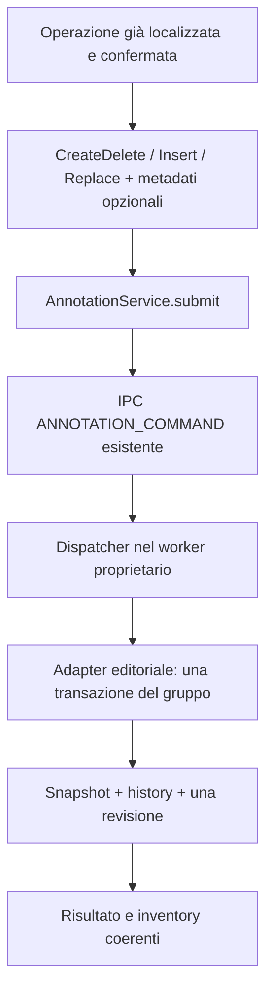

# M19.2 - Analisi architetturale delle correzioni motivate

**10 novembre 2026 - sola analisi, nessuna implementazione M19.2.**

Consiglio di estendere i tre comandi editoriali esistenti con metadati opzionali
e di creare correzione e motivazione dentro una sola transazione del worker.
Il motore di snapshot è riutilizzabile, ma non segue automaticamente `/IRT`.
Sono necessari un elenco esplicito dei componenti gestiti, un rollback che
comprenda la preparazione della history e il raccordo degli ID nell'inventory.
Per cancellare in sicurezza anche dopo riapertura serve inoltre una provenienza
persistente verificabile del gruppo; autore e nomi somiglianti non bastano.

## 1. Stato esaminato e perimetro

HEAD: `14a96dc61d28e20d897e0cec50509c18ad1b0575`, release `v0.17.1`.
PyMuPDF verificato: `1.28.2`.

Il working tree contiene le modifiche M19.1 e gli artefatti M19 non committati.
L'analisi considera questi file correnti, non soltanto HEAD. Il contesto fornito
dall'utente conferma il collaudo manuale M19 e M19.1; questa iterazione non
aggiorna automaticamente i precedenti report o gli stati dei gate Adobe.

È stato aggiunto soltanto questo documento. Nessuna modifica al codice, ai test,
a M19/M19.1, ai PDF sperimentali, alle dipendenze o all'EXE stabile. Non sono
stati implementati comandi, parser JSON, localizzatori, chiamate IA, UI o nuove
regole di cancellazione. Nessun packaging, commit, push o tag.

La futura implementazione toccherebbe le parti pertinenti di ANN-08..11,
A-06, AT-CMD-01, AT-EDIT-01..04, AT-SIDE-02..04, AT-ANN-12 e dei gate di
salvataggio/Adobe. **Questa analisi non attribuisce nuovi PASS a quei gate.**

## 2. Architettura attuale: riferimenti al codice

I collegamenti indicano righe dell'attuale working tree, rimasto invariato.

| Responsabilità | File, classe/funzione e comportamento attuale |
| --- | --- |
| Intento editoriale | [annotation_commands.py:191](src/pdf_annotator/domain/annotation_commands.py#L191): `CreateDeleteText`, `CreateInsertText`, `CreateReplaceText`. Target confermato, contesto documento/generazione e ID stabile; `text` è esclusivamente il payload Insert/Replace. Nessun campo motivazione/autore personalizzato. |
| Target e conferma | [targets.py:73](src/pdf_annotator/domain/targets.py#L73): `TextRangeTarget` / `TextInsertionTarget`; [text_service.py:166](src/pdf_annotator/worker/text_service.py#L166): `WorkerTextService.require_confirmed()`. Il worker richiede un target già presente nel proprio registro di conferma, non soltanto una stringa o quad arbitrari. |
| Serializzazione | [serialization.py:264](src/pdf_annotator/domain/serialization.py#L264): `command_to_payload()`; [serialization.py:318](src/pdf_annotator/domain/serialization.py#L318): `command_from_payload()`. Schema discriminato con controllo esatto dei campi. Modelli, risultati e delta hanno ulteriori codec nello stesso modulo. |
| Service comune | [annotation_service.py:62](src/pdf_annotator/services/annotation_service.py#L62): `AnnotationService.submit()`, validazione, capability, backpressure e invio `ANNOTATION_COMMAND`; `poll_document()` / `_adopt_response()` controllano documento, generazione, request e continuità delle revisioni. Il service non dipende da eventi/widget. |
| Worker e revisioni | [document_service.py:201](src/pdf_annotator/worker/document_service.py#L201): dispatch nel processo proprietario; [annotation_dispatch.py:124](src/pdf_annotator/worker/annotation_dispatch.py#L124): `AnnotationCommandDispatcher.dispatch()`, deduplicazione, history e una revisione per esito riuscito. |
| Routing PDF e ownership in sessione | [annotation_adapter.py:58](src/pdf_annotator/worker/annotation_adapter.py#L58): `ProductAnnotationAdapter`, registro `_owned`, delega alle primitive editoriali. Non è un registro persistente recuperato automaticamente dal file. |
| Creazione nativa | [editorial_adapter.py:146](src/pdf_annotator/worker/editorial_adapter.py#L146): `create_editorial()`. [editorial_adapter.py:70](src/pdf_annotator/worker/editorial_adapter.py#L70): `_info()`, autore oggi fisso `PDF Annotator`; `_popup()` e `_caret_geometry()` completano il profilo. |
| Transazione PDF locale | [editorial_adapter.py:36](src/pdf_annotator/worker/editorial_adapter.py#L36): `_page_transaction()`, snapshot di pagina, eventuale array Annots indiretto e componenti esistenti; annulla gli xref nuovi in caso di errore interno al contesto. |
| History | [annotation_adapter.py:36](src/pdf_annotator/worker/annotation_adapter.py#L36): `ProductHistoryEntry`; [annotation_adapter.py:161](src/pdf_annotator/worker/annotation_adapter.py#L161): `history_before()`, `history_after()`, `undo_history()`, `redo_history()`, `history_delta()`. `_snapshot_for()` usa gli xref del backing, non una visita delle relazioni. |
| Snapshot nativi | [external_delete.py:126](src/pdf_annotator/worker/external_delete.py#L126): `snapshot_native_annotation()` cattura i componenti esplicitamente elencati e Annots; [external_delete.py:156](src/pdf_annotator/worker/external_delete.py#L156): `restore_native_annotation()` ripristina dizionari/stream e Annots, con tentativo di rollback se il ripristino fallisce. |
| Cancellazione app-owned | [editorial_adapter.py:200](src/pdf_annotator/worker/editorial_adapter.py#L200): `delete_editorial()`, verifica nomi e grafo Replace, include i Popup e rifiuta riferimenti entranti estranei. Il chiamante è `DeleteAnnotation` attraverso `_owned`. |
| Cancellazione esterna | [external_delete.py:42](src/pdf_annotator/worker/external_delete.py#L42): `safe_components()` e `delete_external_annotation()`. Un reply non è cancellabile autonomamente; un padre con risposte viene rifiutato. `DeleteExternalAnnotation` è autorizzato anche dal service sulla capability corrente. |
| Inventory M19.1 | [annotation_inventory.py:176](src/pdf_annotator/worker/annotation_inventory.py#L176): `_scan()`; [annotation_replies.py:9](src/pdf_annotator/worker/annotation_replies.py#L9): `associate_replies()`. Mantiene le risposte nell'inventory, separa R da Group, risolve la radice e conserva anomalie accessibili. Non è un'autorizzazione alla cancellazione. |
| Proiezione GUI | [document_manager.py:539](src/pdf_annotator/app/document_manager.py#L539): adozione risultati/delta; [document_manager.py:612](src/pdf_annotator/app/document_manager.py#L612): `_app_annotation_summary()`, `_seed_app_inventory()`, `_is_app_backing_summary()`. |
| Save/Save As | [save_coordinator.py:89](src/pdf_annotator/app/save_coordinator.py#L89), [document_service.py:176](src/pdf_annotator/worker/document_service.py#L176), [save_service.py:57](src/pdf_annotator/worker/save_service.py#L57): barriera di revisione, candidato, validator, sostituzione e riapertura. |
| Preservazione e locator | [save_validation.py:89](src/pdf_annotator/worker/save_validation.py#L89): `semantic_digest()` include chiavi sconosciute e relazioni raggiungibili; `locator_digest()` a riga 135 protegge gli xref necessari alla history; `inspect_document()` a riga 190 verifica anche la struttura Replace. |

### Profili PDF effettivi

| Operazione | Annotazione principale | Altri oggetti |
| --- | --- | --- |
| Delete | StrikeOut, range nei QuadPoints, Contents assente | Popup della radice |
| Insert | Caret, payload in Contents e RC, confine in Rect/RD | Popup della radice |
| Replace | Caret con IT Replace e payload in Contents/RC | StrikeOut con IT StrikeOutTextEdit, RT Group, IRT verso il Caret; un Popup per componente |

La motivazione dimostrata da M19 è un ulteriore Text con Contents separato,
IRT verso la radice, RT R e proprio Popup. Non si cambia RT Group dello
StrikeOut, non si sposta il payload editoriale nella risposta e non si modifica
il contenuto della pagina.

## 3. Soluzione consigliata e alternative

### Estendere i comandi esistenti

Proporrei un piccolo DTO immutabile opzionale di metadati editoriali, condiviso
dai tre comandi: autore e motivazione plain text opzionale. Il nome preciso del
DTO non è una decisione architetturale; `EditorialMetadata` è un nome indicativo.
L'assenza del DTO conserva il comportamento dei chiamanti esistenti. Il campo va
aggiunto preservando le firme posizionali attuali o rendendo i nuovi dati keyword-only.

`CreateInsertText.text` / `CreateReplaceText.text` restano il testo editoriale.
Per Delete il Contents principale rimane assente: la spiegazione vive soltanto
nella risposta. `None` significa nessuna motivazione; per una motivazione
presente raccomando testo non vuoto, Unicode valido, senza trim/normalizzazione
del contenuto accettato. Il limite esistente di 16.384 caratteri per i nuovi
payload plain text è un punto di partenza ragionevole; autore e dimensione IPC
complessiva richiedono limiti espliciti. La lettura delle risposte esterne lunghe
M19.1 non deve essere limitata a quel limite di creazione.

I codec devono accettare l'assenza dei nuovi campi legacy, validare i campi
presenti e preservare i dati anche in `AnnotationModel`, risultati e delta
quando necessari. Va decisa esplicitamente la politica di versione dello schema.
Il modello restituito deve identificare il gruppo e le risposte gestite con
metadati immutabili e backing completi; non deve riutilizzare `AnnotationModel.text`
per la spiegazione. I summary possono trasportare i riferimenti e gli autori,
mentre il testo integrale delle risposte continua nel canale detail M19.1.

Il worker continua a chiamare **una sola** `create_editorial()`, estesa con un
piccolo helper privato per la risposta. Non si importa `experiments/m19` nel
prodotto e non si mantiene un writer parallelo. Lo spike M19 è evidenza e
fixture, non un secondo percorso operativo.

L'autore va applicato ai nuovi componenti nella fase di costruzione, prima del
posizionamento definitivo del Caret. Non si deve aggiungere tardivamente un
`set_info()`/`update()` alla radice già posizionata: M19 ha documentato la possibile
rigenerazione della sua geometria in 1.28.2. NM, date e relazioni sono generati
una volta; redo ripristina lo snapshot invece di rigenerarli.

| Alternativa | Valutazione |
| --- | --- |
| Metadati opzionali sui tre Create | **Consigliata**: stessa semantica, validazione, trasporto, revisione e history; nessun nuovo tipo di strumento. |
| Un comando dedicato che contiene un Create e la motivazione | Possibile, ma introduce wrapping, serializzazione e riconoscimento aggiuntivi senza un requisito attuale che lo giustifichi. Se scelto, deve comunque essere un solo dispatch/transazione, non due invii. |
| Create della correzione seguito da AddReply separato | Non adatto al requisito: due punti di fallimento, possibile correzione incompleta, due revisioni/Undo. |
| Batch generico o nuova API IA/automazione | Sproporzionato e fuori perimetro. |

### Confine del futuro chiamante programmatico

L'esempio JSON dell'utente descrive un intento, non è un comando eseguibile:
mancano documento/generazione, pagina, selezione/confine confermati, snapshot
testuale e geometria canonica. Il futuro localizzatore deve ottenere la conferma
autorevole del worker tramite il servizio dei target; non può semplicemente
inventare quad o cercare un'occorrenza uguale dentro l'adapter editoriale.

Un caller senza widget potrà costruire i DTO e usare il service/trasporto già
previsti, con una sessione pronta e il relativo event loop non bloccante.
Non propongo un endpoint pubblico nuovo. `CommandSource.AI` già esiste come
provenienza di dominio, ma non implementa né autorizza un motore IA. L'autore del
commento è un dato esplicito, non una deduzione automatica da quella enum.

## 4. Atomicità: cosa è riutilizzabile e cosa manca

### Snapshot esplicito del grafo

`PdfBackingReference` contiene oggi radice e `associated_xrefs`.
`ProductAnnotationAdapter._backing_xrefs()` a riga 264 li passa a `_snapshot_for()`.
Per una correzione motivata devono comprendere anche ogni risposta gestita e
il relativo Popup. Va conservata inoltre la distinzione dei ruoli: componente
Replace, Popup e risposta non sono equivalenti soltanto perché associati.

Lo snapshot non segue IRT, Popup o tutte le dipendenze AP ricorsivamente.
Per i profili noti occorre elencare gli oggetti necessari; l'opzione
`include_normal_appearance` cattura l'AP normale diretto quando va preservato
anche contro una sovrascrittura. Le risorse AP immutabili possono continuare a
essere mantenute tramite i locator e il save conservativo attuali. Non si deve
introdurre un garbage collector generale o cancellare risorse condivise.

**Diagnostica in memoria, exit 0:** sul Replace M19 lo snapshot dei soli quattro
componenti correnti non include Text e Popup della motivazione. Modificando
soltanto Contents della risposta e ripristinando tale snapshot, Contents non
torna al valore originale. Elencando tutti e sei i componenti, il ripristino
riesce. Questo dimostra il limite della cattura esplicita; non implica che ogni
Undo corrente lasci necessariamente una nota visibile, perché viene ripristinato
anche l'array Annots. Dimostra che non è garantito il ripristino integrale del
reply se il suo oggetto non è nello snapshot.

### Lacuna oltre il confine della transazione attuale

Il contesto `_page_transaction()` termina dentro `create_editorial()` prima di
`history_after()` e della registrazione della history nel dispatcher.
`rollback_history_before()` a riga 201 dell'adapter protegge gli edit esterni,
ma non ripristina le creazioni app-owned.

**Diagnostica in memoria, exit 0:** forzando un RuntimeError in `history_after()`
dopo una normale CreateReplace senza motivazione, il risultato è fallimento,
revisione 0 e history vuota; rimangono però quattro oggetti annotazione sulla
pagina e un modello in `_owned`. È un limite già presente, non una regressione
creata da M19.2. Deve essere chiuso prima di promettere atomicità della nuova
operazione. Non è stato corretto in questa iterazione.

### Transazione proposta

Un piccolo contesto transazionale del percorso editoriale, coordinato tra
dispatcher e adapter, deve coprire:

1. Validazione completa di target, testo, metadati, identità e dimensioni prima
   delle scritture. Cattura di Annots diretto/indiretto, componenti già esistenti,
   limite iniziale degli xref e stato del modello coinvolto.
2. Creazione dei componenti editoriali con il profilo corrente; creazione della
   risposta e del suo Popup; scrittura di IRT/RT, autore e identità di gruppo.
3. Verifica del grafo completo, costruzione del modello definitivo, snapshot
   after e metadati leggeri necessari per i delta della history.
4. Preparazione/validazione dell'entry di history e del risultato serializzabile,
   compresi i dati che dovranno attraversare il limite IPC. Non pubblicare prima
   una creazione parziale all'inventory.
5. Un solo commit: registro `_owned`, una entry di history, una revisione e un
   risultato di successo. Preparare gli oggetti prima di modificare contatori,
   cursor e stato di history, oppure includerne il ripristino nel guard.

Qualunque errore successivo alla prima scrittura, inclusi errori di dominio,
snapshot, registrazione/serializzazione locale del risultato, deve ripristinare
Annots, oggetti coinvolti e `_owned`, senza revisione o history fantasma. Gli xref
nuovi della transazione possono essere annullati come nel guard esistente.
Se il rollback stesso fallisce, la sessione deve diventare inutilizzabile per
ulteriori mutazioni/Save con il percorso d'errore del worker; non restare
apparentemente scrivibile. L'invio IPC fallito dopo un commit è un problema di
esito non conosciuto/sessione fallita, non un motivo per replicare alla cieca il
comando. Non si promette qui recovery persistente dopo crash del processo.

Questo richiede un'estensione locale del confine transazionale, non una seconda
coda, un secondo worker o un framework generale. Una motivazione non deve essere
un secondo comando interno eseguito dopo il commit della correzione.

### Undo/redo

Una entry `ProductHistoryEntry` deve catturare before/after del gruppo completo.
Undo di Create rimuove tutti gli oggetti annotazione gestiti; redo ripristina
gli stessi dizionari, identità, Contents, date, IRT/RT e geometrie. Per Delete si
inverte lo stesso rapporto. Non si richiama il writer per ricostruire il gruppo
da testo e coordinate: si perderebbero varianti e metadati.

Anche i delta devono includere le risposte: rimozione dei loro summary/detail,
reinserimento dei summary al ripristino e invalidazione dei dettagli coinvolti.
`HistoryDelta` possiede già campi per modelli app e summary nativi: sono
riutilizzabili, senza un nuovo sistema IPC. Le preview restano limitate e i testi
completi continuano a usare i chunk. I byte aggiunti agli snapshot devono essere
contabilizzati nel budget history esistente, con test sul caso di entry grande.

## 5. Cancellazione e provenienza conservativa

### Regola consigliata

Distinguere **leggibilità** di una relazione da **autorizzazione a rimuoverne
gli oggetti**. Il resolver M19.1 serve alla prima, non prova la seconda.

Durante la sessione il gruppo può essere autorizzato dal registro `_owned` e
dall'elenco esatto dei componenti creati. Dopo chiusura e riapertura `_owned` è
vuoto, i summary sono nativi/esterni e i vecchi target confermati non sono più
validi: non va ricostruito artificialmente un Create con un target M6 inesistente.

Raccomando una piccola descrizione persistente versionata, in un namespace
privato dell'app sul gruppo: ID stabile, profilo editoriale e ID/NM espliciti
delle risposte gestite. Nome della chiave e formato definitivo sono da decidere.
Gli xref rimangono locator della sessione e non vanno usati come identità durature.
Il marker non è una firma di autenticità: va sempre verificato insieme al grafo.

Un collector del worker autorizza la cancellazione soltanto se:

- profilo e versione sono riconosciuti, ID univoci e tutti gli oggetti dichiarati
  sono presenti sulla pagina prevista;
- radice e, per Replace, StrikeOut rispettano gli intent e la direzione Group;
- le risposte gestite sono Text con la relazione documentata alla radice e
  i Popup hanno Parent coerenti;
- il gruppo è chiuso: nessun riferimento entrante da un oggetto estraneo,
  incluse risposte a una risposta, riferimenti anomali o da altre pagine;
- non sono presenti componenti condivisi o strutture non rappresentabili con
  il profilo conosciuto. Il controllo usa i riferimenti PDF, non l'elenco
  appiattito delle sole risposte visibili nella sidebar.

La verifica autoritativa precede ogni Delete/Undo che rimuove il gruppo. Il
collector e i ruoli sono condivisi da cattura snapshot, cancellazione e
capability, evitando tre definizioni diverse di appartenenza.

### Casi da distinguere

| Caso | Comportamento proposto |
| --- | --- |
| Gruppo creato nella sessione, composto soltanto da componenti registrati | Delete della radice rimuove correzione, risposte gestite e Popup in una sola transazione; un Undo/Redo agisce sull'intero gruppo. |
| Gruppo salvato e riaperto, marker e grafo validati | Stessa cancellazione coordinata, tramite un percorso nativo di gruppo gestito; nuova entry di history della sessione corrente. Non si recupera la vecchia history dopo la chiusura. |
| Più risposte tutte esplicitamente gestite | Il collector include l'elenco completo, non soltanto la prima risposta o il suffisso M19 `:reason`. Il Create iniziale può comunque aggiungerne soltanto una. |
| Risposta aggiunta successivamente da Acrobat | Resta leggibile con M19.1, ma è estranea all'elenco gestito: **bloccare l'intera cancellazione**. Non cancellare il padre lasciando un'orfana e non adottare automaticamente la nuova risposta. |
| Oggetto gestito modificato da Acrobat mantenendo ID, marker e profilo valido | Snapshot del contenuto corrente prima della cancellazione; Undo ripristina anche le modifiche esterne, non il vecchio testo originario. Se non si può provarne la mappatura, gruppo non cancellabile. |
| Marker assente, duplicato, rimosso o non riconosciuto | Preservazione e sola lettura per la cancellazione di gruppo. Non dedurre ownership da `Revisione IA`, NM simili o geometria. |
| IRT anomalo, cicli, riferimento cross-page, componente inatteso | Rifiuto senza mutazioni; le annotazioni consultabili restano accessibili secondo M19.1. |
| Eliminazione della sola risposta | Non introdurla implicitamente in M19.2. Se richiesta in seguito, comando dedicato e atomico solo per risposte gestite, con aggiornamento del marker e snapshot; niente Delete generico sulle Text collegate. |

I campioni M19 attuali non possiedono questo futuro marker e non vanno migrati
o autorizzati automaticamente soltanto perché furono generati dallo spike.

### Integrazione della cancellazione senza ampliare M15.1

In sessione si riusa `DeleteAnnotation` con il modello app-owned e si estende
`delete_editorial()` al gruppo verificato. Dopo riapertura si può riusare il
trasporto di cancellazione nativo esistente (`DeleteExternalAnnotation`), facendo
diramare il worker **soltanto** sul profilo app-managed validato prima del
fallback esterno. Anche il relativo snapshot/redo deve utilizzare lo stesso
collector: oggi `history_before()` e `redo_history()` richiamano direttamente
le funzioni di cancellazione esterna che rifiutano le risposte.

L'alternativa è un comando esplicito di cancellazione managed; non è necessario
per il trasporto, ma può essere preferito per la chiarezza del dominio. È una
decisione da fissare prima del codice. In entrambi i casi serve la capability
specifica di quel profilo gestito; non si allarga la whitelist M15.1 né si
aggirano i controlli in UI/service o nel worker. I gruppi davvero esterni restano
governati dalle regole conservative attuali.

Non usare `Annot.delete_responses()` come scorciatoia: la
[documentazione PyMuPDF](https://pymupdf.readthedocs.io/en/latest/annot.html#Annot.delete_responses)
la definisce una cancellazione di tutte le risposte e dei Popup. Non distingue
il nostro insieme autorizzato dalle risposte esterne da preservare.

## 6. Inventory M19.1, salvataggio e interoperabilità

### Identità della sessione e aggiornamenti

Il reader esistente è riutilizzabile per il PDF nativo, ma non basta collegare
IRT nel writer. Oggi `_app_annotation_summary()` usa `annotation_id.value` come
logical ID e non riporta le risposte; il resolver usa invece `native:pagina:xref`
come padre. `_is_app_backing_summary()` fa scartare il summary nativo della
radice già rappresentata dal modello app.

**Diagnostica senza scritture PDF, exit 0:** proiettando i DTO M19 come una
radice app live, la radice nativa verrebbe filtrata; il padre della risposta non
coincide con l'ID app e `is_attached_reply()` restituisce False. Il summary app
ha zero reply_ids, quello nativo ne ha uno. Non è un fallimento del caso M19.1
di lettura su riapertura: è un'integrazione mancante per la futura creazione live.

Serve un solo raccordo degli alias nel manager/service: riconoscere la radice
nativa dal backing del modello, conservare NM/xref originali e fondere i metadati
delle relazioni nel summary app, senza duplicare o sostituire il modello ricco.
Le risposte rimangono record nativi; il loro padre di presentazione deve
risolversi all'ID effettivamente presente in inventory. Non vanno alterati gli
IRT salvati per risolvere un problema di ID GUI.

Il risultato/delta può usare i campi già esistenti per aggiungere una radice e
i summary delle risposte insieme. In alternativa si usa il refresh asincrono
esistente, ma dopo aver corretto il raccordo: un semplice refresh con l'attuale
filtro non risolve il problema. Create/Delete/Undo/Redo devono invalidare i
detail e segnalare gli ID di tutte le parti interessate per respingere chunk
tardivi. Non modificare la conservazione dei legami sugli edit M15.1 che non
cambiano IRT/RT; l'invalidazione della topologia va distinta da un semplice Move.

### Save e riapertura

Non emerge una necessità di cambiare la pipeline Save/Save As. Il percorso di
produzione esaminato usa un candidato full-save con `incremental=False`,
`garbage=0`, `clean=False`, `use_objstms=0`, validazione e sostituzione conservativa.
Non assumo che venga usato un save incrementale perché previsto come preferenza
nei documenti: questa è la pipeline effettiva, da lasciare invariata per M19.2.

Il digest semantico include chiavi e riferimenti sconosciuti, mentre quello dei
locator protegge le risorse della history anche quando temporaneamente non
raggiungibili da Annots. Il validator non conosce però la futura regola di
ownership: preservare un grafo non dimostra che la sua creazione sia corretta.
Il collector/adapter deve garantire l'invariante alla mutazione; test mirati
verificano la sua preservazione attraverso il salvataggio.

Nella stessa sessione `adapter.rebind()` e `dispatcher.rebind_generation()`
mantengono modelli/history dopo Save. Alla vera chiusura e riapertura non viene
recuperata una history persistente: si ricostruiscono solo i gruppi nativi e la
loro eventuale gestibilità dal marker, senza ricreare annotazioni o target M6.

### Acrobat

Si mantiene il profilo M19: Text con IRT verso la radice e RT R; il Group di
Replace rimane distinto. La [PDF Reference Adobe, tabella 8.17](https://opensource.adobe.com/dc-acrobat-sdk-docs/pdfstandards/pdfreference1.6.pdf)
consente una risposta normale alla radice di un gruppo. La
[API PyMuPDF set_irt_xref](https://pymupdf.readthedocs.io/en/latest/annot.html#Annot.set_irt_xref)
richiede un'annotazione sulla stessa pagina e non necessita di update; RT viene
gestito separatamente come già verificato in M19. Gli eventuali metadati privati
vanno scritti solo dal worker con l'API documentata
[xref_set_key](https://pymupdf.readthedocs.io/en/latest/document.html#Document.xref_set_key),
che non sostituisce la verifica semantica del grafo.

L'evidenza Acrobat di M19 è una base, non qualifica automaticamente il nuovo
writer di produzione, il marker o il lifecycle completo. Vanno ripetuti app
Create/Save As -> Acrobat -> Save -> app, verificando anche la permanenza del
marker. Se Acrobat lo rimuove o modifica il grafo in modo non riconoscibile,
continuare a leggere con M19.1 e disabilitare la cancellazione managed. Nessuna
conclusione nuova su InDesign/Accept deriva da questa analisi.

## 7. Regressioni da implementare e basi riutilizzabili

| Gruppo | Prove richieste | Test esistenti da estendere |
| --- | --- | --- |
| Create dei tre tipi | Con/senza motivo, payload editoriale separato, autore, date, Unicode, spazio iniziale/finale, nessuna modifica a testo/stream/render base | `tests/test_editorial_persistence_m10.py:86` e `:113`; fixture M19 |
| Grafo nativo | Radice corretta, Group intatto, R distinto, Popup/Parent coerenti, ID unici, componenti completi | `tests/test_annotation_replies_m191.py:77` e `:106` |
| Atomicità PDF | Iniettare errori dopo creazione radice, risposta, Popup, IRT, RT, metadata e validazione finale; stato identico al before, nessun componente parziale | `tests/test_editorial_persistence_m10.py:168`, `tests/m10_helpers.py:failure_worker` |
| Atomicità oltre l'adapter | Errori in history_after, calcolo entry, registrazione history e preparazione del risultato; fallimenti anche di dominio; rollback fallito -> sessione non scrivibile | Nuove regressioni sui gap diagnosticati; `tests/test_annotation_service.py:247` da approfondire, non basta revision==0 |
| Undo/Redo Create e Delete | Un solo passo, tutti gli oggetti, relazioni e metadati esatti; branch nuovo dopo Undo; Save durante stato undone; altri documenti/annotazioni invariati | `tests/test_undo_redo_m14.py:107`, `:161`, `:326`, `:394` |
| Cancellazione managed | Gruppo chiuso con una/più risposte; rifiuto senza modifiche con estranei, cicli, riferimenti cross-page o marker duplicati; stessa verifica prima/dopo reopen | `tests/test_annotation_replies_m191.py:267`; test external-delete M12 e snapshot M14 |
| Esterni e Acrobat | Nuova risposta Acrobat non adottata; variante ignota preservata; nessuna cancellazione per autore/NM simili; oggetti gestiti modificati ripristinati come erano al Delete | `tests/test_external_edits_m151.py` e `tests/test_save_m15.py:342` |
| Inventory live | Create programmatico immediato: una sola voce, niente icona della risposta, alias app/native corretto, motivo leggibile senza reopen; delta completo dopo Undo/Redo/Delete | Nuovi casi live distinti dai PDF già salvati; `tests/test_annotation_replies_m191.py:139`, `:184`, `:207`, `:297` |
| Save e identity | Save/Save As, generation stale, riapertura reale, xref variati da round trip esterno, marker mancante -> fallback readonly; nessun nuovo schema persistente di history | `tests/test_save_m15.py:84`, `:117`, `:209`, `:368`, `:411`, `:444`; `tests/test_annotation_replies_m191.py:235` |
| Limiti e caller | Dedupe, bad/stale target, rifiuto input grande prima delle scritture, budget history comprensivo delle risposte, nessun testo nei log, nessun nuovo bypass GUI/PDF | `tests/test_annotation_service.py:122`, `:135`, `:158`, `:180`; `tests/test_undo_redo_m14.py:191` |

Il gate manuale Acrobat deve controllare tipo Delete/Insert/Replace, testo
editoriale, motivo come risposta, autore, salvataggio/riapertura e ritorno in
fuPDF. Per la provenienza aggiungere due varianti: solo modifica di una risposta
gestita e aggiunta di una risposta esterna. La prima può restare gestibile solo
se il profilo è verificabile; la seconda deve bloccare la cancellazione completa.
Non ricreare/riparare in Acrobat il campione per far passare la prova.

## 8. Decisioni da fissare prima dell'implementazione

| Decisione | Raccomandazione |
| --- | --- |
| Comando e cardinalità iniziale | Estendere i tre Create con metadati opzionali; una motivazione iniziale. Collector predisposto a un elenco esplicito di risposte gestite, non a una scansione indiscriminata. |
| Provenienza dopo reopen | Marker app versionato con ID dei componenti; se manca/non è verificabile, conservare e non autorizzare Delete di gruppo. Nessuna migrazione automatica dei PDF M19. |
| Risposte esterne aggiunte | Bloccare l'intera cancellazione del gruppo; nessuna adozione o inclusione implicita. |
| Solo risposta | Escludere la cancellazione autonoma da M19.2; mantenerla come decisione futura esplicita. |
| Contratto Delete dopo reopen | Preferenza per riusare il trasporto nativo con routing del profilo managed; valutare un nome/comando dedicato solo se necessario alla chiarezza del dominio. Il vecchio nome External non deve diventare un'autorizzazione generica. |
| Metadati e limiti | Un autore esplicito per correzione e risposta, date generate nel worker, motivo presente non vuoto e preservato esattamente; fissare limiti autore/numero risposte e politica di schema. |
| Affidabilità minima | Rollback fino alla preparazione di history/risultato e grafo completo negli snapshot sono prerequisiti, non miglioramenti da rinviare dopo il writer. |
| Qualificazione | Ripetere Acrobat sul percorso di produzione e verificare la permanenza del marker prima di abilitare cancellazione managed dopo round trip. |

Non vedo necessità di cambiare stack, modello di processi, coordinate canoniche,
pipeline Save o capability policy generale M15.1. La nuova gestione di gruppi
app-owned richiede invece una capability specifica e verificata, coerente in
service, worker e inventory: è una parte esplicita della futura M19.2.

## 9. Verifiche svolte in questa iterazione

- Ricognizione statica dei moduli indicati, dei profili M19 e dei test pertinenti.
- Due invocazioni diagnostiche Python da stdin, **exit 0**, usando solo copie in
  memoria dei PDF esistenti: cattura snapshot a 4/6 oggetti e failure prima della
  history; proiezione degli ID app/native. Nessun PDF o script diagnostico salvato.
- Snapshot standard: reply non incluso e Contents non ripristinato; snapshot
  espanso: reply incluso e Contents ripristinato. Failure history_after:
  success=False, revisione=0, history=0, oggetti rimasti=4, modelli owned=1.
- Proiezione live: radice nativa filtrata=True, parent ID diverso=True,
  risposta associata=False, reply_ids app=0 e nativi=1.
- Confronto SHA-256 prima/dopo su 188 file di codice/test, artefatti M19,
  documenti normativi, report precedenti, pyproject ed EXE stabile:
  **188 invariati, zero modificati, zero aggiunte in quell'insieme**.
- `git diff --check`: exit 0; soltanto avvisi Git LF/CRLF sulle modifiche M19.1
  preesistenti, nessun errore whitespace.
- Nessuna esecuzione pytest o full suite, nessuna nuova prova manuale Adobe:
  non vi è implementazione da qualificare. I test della sezione 7 sono proposti,
  non dichiarati eseguiti da M19.2.

Il solo file nuovo di questa iterazione è `M19_2_ANALYSIS.md`. L'implementazione
deve attendere la discussione di questo report.
