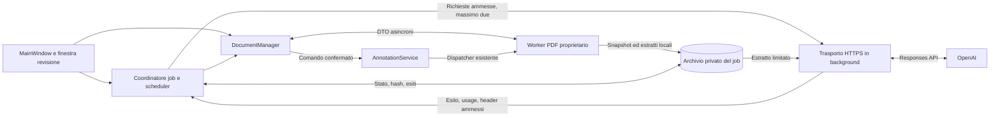

# fuPDF M21.1 — Progetto di integrazione della revisione IA

Proposta progettuale sul commit `920789c3db10fa297d5fd0f7ad9b46d0ea9b2e75`. L'integrazione mantiene il contratto `corrections.json` e l'encoding nativo M19/M20. Il collaudo Acrobat riportato dall'utente riguarda il campione M20. La nuova integrazione richiederà un proprio collaudo attraverso l'interfaccia.

## 1. Confine di prodotto e riuso

`PROJECT_SPEC.md` §2–3 esclude IA e servizi di rete da v1. Prima dell'implementazione, aggiornare esplicitamente il perimetro successivo a v1 in `PROJECT_SPEC.md`, `ARCHITECTURE.md` e `ROADMAP.md` per il solo flusso avviato dall'utente. L'editor resta utilizzabile offline. La progettazione qui descritta lascia in vigore A-01–A-06 e i vincoli di scrittura nativa, con la precisazione necessaria per gli estratti al §3.

| Componente esistente | Riuso proposto |
| --- | --- |
| [`MainWindow`](src/pdf_annotator/app/main_window.py), [`DocumentSession`](src/pdf_annotator/app/document_session.py), [`DocumentManager`](src/pdf_annotator/app/document_manager.py) | Menu File, schede, stato per sessione, polling Qt con lavoro limitato per tick, eventi di salvataggio, riapertura e chiusura. Il job segue l'ID della sessione di origine. |
| [`WorkerClient`](src/pdf_annotator/worker/client.py), [`protocol.py`](src/pdf_annotator/worker/protocol.py), [`document_service.py`](src/pdf_annotator/worker/document_service.py) | Processo persistente proprietario del PDF, trasporto asincrono e DTO con documento, generazione e richiesta. Oggi `WorkerClient` usa una FIFO con un solo scambio alla volta e coda limitata. Il contratto di priorità va attuato al punto di ammissione del lavoro IA. |
| [`SaveCoordinator`](src/pdf_annotator/app/save_coordinator.py), [`save_service.py`](src/pdf_annotator/worker/save_service.py) | Precedenza di Save/Save As, drenaggio delle mutazioni, barriera di revisione, riapertura e aggiornamento dell'identità. Il coordinatore Save oggi drena anche le risposte di lettura pendenti. La progettazione deve tenere conto delle risposte di estrazione ancora in volo. |
| [`AnnotationService`](src/pdf_annotator/services/annotation_service.py), [`annotation_dispatch.py`](src/pdf_annotator/worker/annotation_dispatch.py), [`annotation_adapter.py`](src/pdf_annotator/worker/annotation_adapter.py) | Unico percorso di mutazione, con risultato confermato, delta di inventario, revisione, dirty e storia. `editorial_adapter.py`, `managed_corrections.py` e `sticky_note_adapter.py` restano i writer nativi. |
| [`review.py`](experiments/m20/review.py), [`corrections.py`](experiments/m20/corrections.py), [`metrics.py`](experiments/m20/metrics.py), [`prompt_profiles.py`](experiments/m20/prompt_profiles.py) | Estrarre in moduli riusabili le funzioni di composizione PDF/Responses, validazione, consumo, costo e registro. Conservare i prompt e gli ID dei profili come risorse condivise, mantenendo le CLI come chiamanti dello stesso nucleo. Il trasporto M20 è sincrono, perde gli header e non esegue retry. |
| [`localization_text.py`](experiments/m20/localization_text.py), [`localize.py`](experiments/m20/localize.py), [`application_worker.py`](experiments/m20/application_worker.py), [`WorkerTextService`](src/pdf_annotator/worker/text_service.py) | Riutilizzare ricerca deterministica, quad, fallback, associazione dei glifi e conferma di range/caret. Il `WorkerPlan` sperimentale è vincolato a hash del file e generazione 1. Il `WorkerClient` di `apply.py` è sincrono e la CLI salva una nuova copia. L'integrazione userà il client di produzione, con riconferma compatibile con il lifecycle della scheda. |

Il codice ispezionato offre primitive di trasporto, annullamento di rendering, apertura e salvataggio. Per la revisione serve un coordinatore dedicato all'applicazione, con scheduler, stato dei job e archivio locale. Le altre aggiunte sono tre operazioni IPC proposte (`REVIEW_SNAPSHOT`, `REVIEW_EXTRACT` e `REVIEW_CONFIRM`), un piccolo adattatore credenziali Windows e una finestra Qt. Tutte le mutazioni continuano a transitare per `ANNOTATION_COMMAND`.

## 2. Interfaccia e flusso

In **File → Revisione con IA…**, aprire una finestra non modale, un'istanza per applicazione, agganciata alla scheda selezionata all'apertura. Mostrare documento, profilo `schoolbook`, opzione documento intero o intervallo inclusivo e i tre campi editoriali indipendenti, inizialmente vuoti. Mostrare le posizioni fisiche 1-based all'utente con conversione unica agli indici 0-based, chiarendo la differenza dalla numerazione stampata. Un comando «Chiave API…» nella finestra apre configurazione, sostituzione o rimozione. La conclusione di un job non sposta la scheda attiva.

«Avvia» autorizza l'invio delle pagine da revisionare e delle vicine usate come contesto, anche fuori dall'intervallo richiesto. La finestra mostra il riepilogo prima dell'avvio, il costo come stima e la possibilità di interrompere. Durante il job la stessa finestra espone pagina/range falliti, «Riprova batch falliti», dettagli sintetici e percorso del report. Un indicatore discreto nella status bar riapre il monitor. La sidebar destra resta riservata alle annotazioni. La scelta di profilo governa le istruzioni, mentre la modalità PDF multimodale è fissa in questa fase.

## 3. Snapshot, estratti e convivenza con il viewer

**Proposta per lo spike.** All'avvio registrare ID sessione, generazione, parametri e ultime mutazioni già accettate. Inserire un punto d'ordine prima delle mutazioni successive, con il `document_revision` effettivo verificato dal dispatcher. Lo snapshot include le annotazioni già confermate anche se non salvate. Se è in corso Save As, attendere la relativa adozione prima di acquisire la barriera. Durante la cattura, accodare o differire esplicitamente le nuove mutazioni secondo il backpressure esistente. Non accodare richieste illimitate per simulare reattività.

Il worker serializza il documento corrente su un file privato temporaneo del job con la scrittura completa PyMuPDF, preservando le strutture rilevanti per l'estrazione. Misurare la variante con `no_new_id=True`, senza compattazione o pulizia, partendo dalle opzioni della scrittura completa esistente. Pubblicare il file soltanto dopo la chiusura della scrittura. Il trasporto IPC restituisce un handle logico relativo alla directory del job, revisione, conteggio e identità. SHA-256 calcolato in streaming fuori dal thread Qt prima di ammettere batch, senza portare l'intero PDF in RAM. Consentire letture dell'originale e uno snapshot per job attivo, mantenendo il temporaneo distinto da origine e destinazione di Save. La cattura deve lasciare invariati stato vivo, xref, annotazioni, revisione, dirty, cronologia e file sorgente. Queste proprietà vanno misurate, perché serializzare con PyMuPDF è una chiamata monolitica e la pipeline Save esistente riapre normalmente un file al termine. [PyMuPDF Document](https://pymupdf.readthedocs.io/en/latest/document.html)

**Incompatibilità da risolvere prima di implementare.** `insert_pdf` richiede un sorgente e un documento destinazione modificabile. Per ritagliare lo snapshot mentre il PDF della scheda resta aperto, la soluzione minima proposta consente nel **medesimo worker** di aprire lo snapshot soltanto per lettura e creare un unico `Document()` temporaneo per l'estratto. Sono oggetti di lavoro chiusi prima del ritorno, privi di sessione e accesso dal viewer. La scrittura va solo nel temporaneo dell'estratto. La regola «un solo documento aperto» di `ARCHITECTURE.md` §5 e quella sul documento scrivibile di `AGENTS.md` vanno precisate esplicitamente per questo caso. Restano un solo proprietario del documento vivo, tutti gli oggetti sul medesimo thread del processo e nessun altro processo PyMuPDF. Se la regola resta letterale, il ritaglio PyMuPDF di M20 non può essere riusato mentre il documento rimane aperto. Anche `convert_to_pdf` in 1.28.2 crea internamente un secondo PDF, ricostruisce le pagine tramite un dispositivo di uscita e restituisce byte in memoria. Per questo non sostituisce la copia strutturale di M20. [PyMuPDF `insert_pdf`](https://pymupdf.readthedocs.io/en/latest/document.html#Document.insert_pdf) · [PyMuPDF e threading](https://pymupdf.readthedocs.io/en/latest/recipes-multiprocessing.html)

**Gate di latenza.** Misurare cattura e singoli estratti su documenti lunghi, pagine con risorse condivise pesanti e schede concorrenti. Misurare il p95 di attesa per render visibile, selezione e mutazione, il working set e gli effetti di disco pieno, annullamento e shutdown. La GUI resta asincrona, ma durante una chiamata MuPDF il worker non può servire la stessa scheda. Se la cattura o un singolo estratto occupano il worker troppo a lungo, la variante non supera il gate. Aumentare il timeout ordinario o tenere bloccate le mutazioni per tutta l'analisi non rende praticabile la cattura. Un altro meccanismo di snapshot richiederebbe un riesame dell'architettura e una nuova prova.

**Pianificazione degli estratti.** Partizionare le pagine richieste in blocchi contigui di massimo quattro. Per `4–7`, l'estratto contiene `3–8` quando esistono entrambe le pagine vicine. Registrare ogni pagina come `target` o `context`, con posizione nell'allegato e indice originale. M20 manda un PDF Base64 inline. Salvare l'estratto su temporaneo e controllare **20.000.000 byte di PDF**, contesti inclusi, prima di leggerlo o codificarlo in Base64. Misurare l'uso di memoria interno a `insert_pdf` anche per un estratto respinto. Per un estratto troppo grande provare blocchi da due e poi da una pagina, ricalcolando le vicine. Un blocco sostituito ha solo figli attivi nella contabilità. Se una pagina con il suo contesto disponibile supera ancora il limite, marcarla esplicitamente non elaborabile con motivazione e proseguire. Tenere conto del limite di contesto del modello separatamente dal peso del file. Mantenere al massimo i due estratti pronti/in volo entro il budget di staging complessivo, incluso l'overhead Base64 e JSON. Generare i batch a richiesta, senza limite di pagine sul documento totale. [OpenAI Docs sugli input PDF](https://developers.openai.com/api/docs/guides/file-inputs)

Il prompt tecnico di richiesta esplicita entrambi i ruoli. Structured Outputs vincola `page_index` alle pagine target del blocco, attraverso gli stessi estremi fisici di M20 quando contigui. La validazione locale verifica nuovamente l'insieme target e rifiuta il batch che restituisce correzioni su pagine di contesto. L'estratto porta solo i contenuti delle pagine scelte. Verificare testo, immagini, font, rotazioni, CropBox e la conservazione delle annotazioni da includere nella vista analizzata sul campione. La dimensione resta un criterio di ammissione e non una stima dei token.

**Scheduling PDF.** Ammettere una sola operazione IA breve per worker alla volta, con priorità a render visibile, selezione, mutazioni manuali e Save. Evitare di riempire la FIFO di lavoro IA e mantenere capacità per l'interazione. Nessun byte PDF nei frame IPC, né lettura file/base64 sul thread Qt. Per Save sospendere l'ammissione di estratti e conferme, lasciar terminare l'operazione in volo e instradare o scartare esplicitamente il relativo risultato prima del drenaggio. Se scartato, ristagiare dallo stesso snapshot con richiesta/generazione nuovi. Il trasporto oggi ha una scadenza ordinaria di 30 s e può terminare il worker. Una scadenza di I/O API non deve mai raggiungere quel percorso. Una cattura strutturalmente non interrompibile richiede un profilo di scadenza provato e cleanup del file parziale alla chiusura, lasciando in vigore le protezioni della sessione e del Save in volo.

## 4. Scheduler Responses e contabilità

Un solo scheduler per l'app governa due slot globali, con budget condiviso per progetto/credenziale e per modello o famiglia quando noto. L'identificativo di configurazione usato in memoria è opaco e non deriva da una credenziale serializzata. I job ricevono turni tra richieste, con attesa indipendente per i bucket in cooldown. Il trasporto esegue un solo POST per tentativo, fuori da GUI e worker PDF. Il limite di concorrenza vale anche per connessioni in chiusura e tentativi annullati che occupano ancora lo slot.

- **Ammissione.** Avviare inizialmente con un singolo tentativo in volo per progetto senza budget osservato. Stimare input incluse le immagini e riservare una quota conservativa che tenga conto del tetto di output. Prima di ogni invio riservare capacità RPM e TPM effettiva, tenendo conto delle prenotazioni in volo e del più restrittivo tra limiti noti locali, del modello e di progetto. Aprire il secondo slot solo quando la capacità è plausibilmente disponibile. Nessuna chiamata aggiuntiva di conteggio obbligatoria. Considerare separatamente budget rate-limit e consumo fatturabile.
- **Feedback.** Leggere dalla risposta un insieme ammesso di `x-ratelimit-limit-*`, `remaining-*` e `reset-*`, incluse le varianti `*-project-tokens`, e convertire i reset in scadenze monotone. Applicare le informazioni in modo conservativo rispetto a risposte fuori ordine e richieste già prenotate. L'assenza di header non annulla un limite noto. Quando il consumo supera la stima, correggere la previsione, ridurre il ritmo e ricalcolare l'ammissione. Per un blocco che non entra nel budget anche a finestra piena, ridurre il batch. Per una pagina ancora non ammissibile, registrare il motivo invece di lasciarla in attesa indefinita.
- **Retry.** Per `429` temporanei e `503` transitori usare il massimo tra `Retry-After` valido, reset rilevanti e backoff esponenziale con jitter, con al massimo due retry automatici oltre al primo tentativo. La scadenza di attesa appartiene allo scheduler e non a un `sleep` su GUI o lavoratore PDF. Su `slow_down` ridurre frequenza e aumentarla gradualmente. Quota/credito insufficiente, autenticazione o permessi, modello assente, richiesta non valida e rifiuti richiedono stato distinto e azione appropriata. Non reinviare automaticamente se cade il collegamento dopo il POST e l'esito è ignoto. Un retry selettivo esplicito può comportare un nuovo addebito. Una risposta incompleta o invalida non copre il blocco e non produce correzioni applicabili.
- **Costi.** Sommare usage verificato per tentativo, una volta sola, compresi gli eventuali token segnalati per risposte incomplete. Persistenza di tariffe e valuta usate, token cached e reasoning quando presenti. Segnalare esplicitamente tentativi con costo ignoto e stima parziale. Accesso ai limiti e al modello dipende dal progetto associato alla chiave. [OpenAI Docs sui limiti](https://developers.openai.com/api/docs/guides/rate-limits) · [Errori API](https://developers.openai.com/api/docs/guides/error-codes)

## 5. Stato e persistenza

**Job.** `preparazione` → `analisi` o `attesa_rate_limit` → `applicazione` → `completato` / `completato_parzialmente`. Usare il risultato parziale quando almeno una pagina ha un esito valido ma mancano pagine o ci sono scarti di applicazione. `interrotto` e `fallito` sono terminali per il ciclo. L'attesa rate limit descrive il job quando nessun suo batch può avanzare per quel motivo. I batch hanno stati separati, tra cui `in_coda`, `preparazione`, `in_volo`, `attesa_retry`, `completato`, `fallito`, `annullato`, `esito_incerto` e `suddiviso`. Risultati e aggiornamenti sono identificati almeno da `job_id`, `snapshot_id`, `batch_id`, `attempt_id`, oltre alle identità IPC dove applicabili.

**Vista.** Mostrare pagine target totali, completate e senza esito, batch completati/rimanenti (i conteggi possono cambiare per suddivisione), proposte valide, annotazioni applicate o scartate, costo accumulato e suoi dati mancanti. Un batch valido con zero proposte completa le sue pagine. «Completata» significa risposta valida per il blocco, senza certificare che il modello abbia trovato ogni errore. Gli scarti di applicazione sono distinti dalle pagine senza analisi.

**Archivio.** Una directory privata per job sotto `%LOCALAPPDATA%\fuPDF\review-jobs`, fuori dalla cartella portabile e dai log normali, con file temporanei pubblicati atomicamente nella stessa directory. Il manifest versionato registra sessione/generazione/revisione iniziali, hash dello snapshot, parametri, versione/hash del prompt e contesto effettivo, piani e discendenza dei batch. Per ogni tentativo registrare stato prima del POST, intervallo assegnato, mappa effettiva, hash dell'estratto, tempi, codici d'errore classificati, request ID quando disponibile, usage e stima. Pubblicare un risultato valido con il JSON delle proposte prima di contare la copertura o permettere l'applicazione. In caso di errore di persistenza fermare l'ammissione del job, lasciando recuperabili i risultati già pubblicati. Conservare gli estratti solo quanto serve all'invio e verificare l'hash a ogni rigenerazione o riuso. Snapshot e risultati sono dati sensibili, protetti dai permessi dell'utente locale. Mantenere lo snapshot finché serve per riprovare e rilasciarlo quando il job non è più riprendibile, preservando il report. Registrare solo diagnostica classificata, senza risposte grezze, PDF o autenticazione nei log.

**Recupero iniziale.** Con la sessione e lo snapshot ancora disponibili, ripetere soltanto i blocchi falliti o non conclusi selezionati, usando lo stesso snapshot e gli stessi parametri. Un ciclo di retry conclude l'analisi dei blocchi recuperati prima di applicarne i nuovi risultati. Conservarne lo storico degli esiti. Un completamento parziale precedente resta visibile e le sue proposte già applicate non vengono rigiocate.

**Dopo riavvio, fase successiva.** Il manifest e i batch validi si leggono già per ispezione e recupero dei dati. La ripresa automatica richiederà snapshot integro, versione del protocollo compatibile, prompt riproducibile e riconciliazione dei tentativi segnati `in_volo` come esito ignoto. Per applicare in una nuova sessione servirà un collegamento esplicito al documento e prova di continuità del contenuto rilevante. Se l'app si chiude dopo una mutazione ma prima della scrittura del ledger, le identità native persistenti e la traccia delle conferme dovranno distinguere il caso già salvato da quello rimasto in memoria. La prima versione conserva dati e indica l'incertezza senza rilanciare automaticamente POST o mutazioni al riavvio.

## 6. Applicazione finale e conflitti

1. **Barriera di analisi.** Attendere lo stato terminale di tutti i batch foglia del ciclo. Usare soltanto risultati validi e persistiti per lo stesso snapshot e job. Applicare automaticamente le proposte confermabili dei blocchi riusciti e riportare le pagine fallite. Un'interruzione esplicita ferma l'avvio di nuove applicazioni e conserva i risultati già raccolti. Durante un'applicazione già in corso arrestarsi tra comandi, mantenendo le mutazioni confermate nella cronologia.
2. **Continuità.** La scheda mantiene un ID stabile. Un Save o Save As completato nella stessa sessione può cambiare path, identità su disco e generazione senza sostituire il contenuto di base. Abilitare il passaggio alla generazione corrente solo in base all'evento di continuità del `SaveCoordinator` e alle verifiche sul bersaglio. Etichettare le risposte di rete con l'identità storica dello snapshot. Creare nuove richieste e comandi per la generazione corrente. Una riapertura indipendente, un worker sostituito senza prova, una sostituzione esterna o una sessione chiusa interrompono l'applicazione automatica su quella sessione. Il nome del file e un hash diverso per sole annotazioni non bastano per decidere la continuità.
3. **Prova del bersaglio.** Localizzare prima rispetto allo snapshot. Conservare identità del contenuto/assetto della pagina e prova minima del bersaglio (testo estratto, contesto utile, segmento di glifi e quad ordinati o bordo del caret). Ricalcolare sul PDF vivo e riconfermare con `WorkerTextService`. Per gli interventi puntuali richiedere una corrispondenza unica e coerente con la prova storica. Una nuova occorrenza uguale altrove non è un bersaglio sostitutivo. Validare l'estrazione del testo di base senza contributi delle annotazioni quando possibile, mantenendo le stesse coordinate e allineando la verifica con l'indice del worker. Il progetto possiede già un esempio con `get_displaylist(annots=False)` in `save_validation.py`. Verificare la stessa resa per CropBox/rotazioni. Se cambia la base di una pagina, rivalutare i relativi bersagli e scartare quelli senza prova sufficiente, mantenendo utilizzabili le altre pagine. Per commenti con pagina provata, riconfermare l'ancora oppure proporre il fallback entro il CropBox, registrando l'eventuale declassamento. Considerare le note già presenti nel posizionamento.
4. **Mutazione e deduplica.** Emettere DTO confermati per `CreateReplaceText`, `CreateDeleteText`, `CreateInsertText` o `CreateStickyNote` tramite `DocumentManager.submit_annotation` e `AnnotationService`. La prova prodotta dal worker lega job, proposal, `command_id`, sessione e generazione. Il dispatcher verifica al commit che la conferma sia ancora utilizzabile e che non ci siano duplicati o conflitti. Si evita così la finestra tra conferma e mutazione in caso di Save As, altri comandi o risposta tardiva. Assegnare ID di comando e annotazione stabili per il tentativo logico e persisterli prima dell'inoltro. Alla riconciliazione usare identità `/NM` e graph M19 verificato, perché gli xref possono cambiare. La cache dei comandi visti è limitata e da sola non basta. Un confronto semantico sul bersaglio confermato, sull'operazione e sul payload aiuta a riconoscere duplicati tra batch/job. Proposte puntuali incompatibili sullo stesso bersaglio vanno riportate e scartate, senza affidare la scelta all'ordine d'arrivo. Un retry non ricrea una proposta già confermata e poi annullata dall'utente.
5. **Ordine e storia.** Applicare in ordine deterministico per pagina e indice di proposta. Limitare l'ammissione per consentire interazione manuale e Save tra mutazioni. Una proposta è una mutazione atomica e un passo Undo/Redo, con root, eventuali componenti e motivazione insieme. Riutilizzare il limite della cronologia e segnalare gli effetti per job molto grandi. Ascoltare gli esiti del servizio per inventario e ledger. Il normale dirty state cambierà dopo la prima mutazione confermata. Il salvataggio resta un'azione dell'utente.

| Evento | Effetto |
| --- | --- |
| Cambio scheda | Il job prosegue sulla scheda d'origine. Le richieste PDF in background cedono al lavoro interattivo. |
| Annotazioni manuali, Undo/Redo | Il job continua sullo snapshot. La revisione corrente non deve coincidere con quella iniziale. Una mutazione IA entra nella storia della sessione nel momento in cui è confermata. |
| Save o Save As durante l'analisi o l'applicazione | L'API può terminare i batch già in corso. Il lavoro PDF cede alla barriera Save. Le proposte successive vengono riconfermate sulla nuova generazione dopo l'adozione del salvataggio della stessa sessione. Il file salvato contiene soltanto le mutazioni che precedono la barriera. |
| Chiusura scheda | Interrompere nuovi invii e mutazioni del job, invalidare le risposte tardive per l'applicazione e conservare gli esiti già acquisiti. Usare il normale dialogo Save/Discard della scheda se dirty. |
| Chiusura app o errore worker | Annullare le code, chiudere o lasciare scadere in background i tentativi attivi e pubblicare lo stato possibile entro un termine. Nessun join sul thread Qt. Dopo un POST può esserci consumo lato servizio anche se il client chiude la connessione. |

## 7. Credenziali Windows e riservatezza

Usare **Windows Credential Manager**, credenziale generica con target stabile di fuPDF per OpenAI e persistenza `CRED_PERSIST_LOCAL_MACHINE` per l'utente Windows corrente. Un adattatore `ctypes` usa `CredWriteW`, `CredReadW`, `CredDeleteW` e `CredFree`, con interfaccia sostituibile nei test. La chiave rimane disponibile allo stesso utente sul PC anche se la cartella portabile viene spostata. Su un altro PC o profilo Windows va configurata di nuovo. Il controllo mascherato mostra lo stato, permette di sostituire o rimuovere la chiave e svuota il campo dopo l'uso. FuPDF distingue credenziale assente, accesso al vault fallito e autenticazione API rifiutata. Il salvataggio della chiave effettua solo controlli locali. [Microsoft Learn: persistenza della credenziale](https://learn.microsoft.com/en-us/windows/win32/api/wincred/ns-wincred-credentialw) · [CredWriteW](https://learn.microsoft.com/en-us/windows/win32/api/wincred/nf-wincred-credwritew) · [CredReadW](https://learn.microsoft.com/en-us/windows/win32/api/wincred/nf-wincred-credreadw) · [CredDeleteW](https://learn.microsoft.com/en-us/windows/win32/api/wincred/nf-wincred-creddeletew)

Il trasporto legge il segreto al bisogno, lo usa solo per `Authorization` su `api.openai.com` con HTTPS verificato, senza redirect, e non lo passa a worker PDF, file, log o report. Lasciare la chiave fuori da `QSettings`, dalla cartella portabile e dai comandi PowerShell della GUI. Sostituzione o rimozione arresta nuovi invii con la configurazione precedente. Per riprendere, l'utente può selezionare i batch falliti con la nuova credenziale. Ridurre la permanenza in memoria senza promettere l'azzeramento di tutte le copie Python/Qt. `store:false` e l'invio inline riducono la persistenza applicativa remota. La conservazione lato servizio resta soggetta alle impostazioni del progetto e alle eccezioni documentate. [OpenAI Docs sui controlli dei dati](https://developers.openai.com/api/docs/guides/your-data)

## 8. Sequenza proposta e prove mirate

Nomi di file futuri indicativi. I percorsi `app/`, `worker/`, `services/` e `util/` sono relativi a `src/pdf_annotator/`. Le prove sono gate da eseguire nelle relative milestone, con server simulato e fixture locali dove possibile.

| Milestone | Perimetro e file previsti | Prove mirate |
| --- | --- | --- |
| **M21.2 — Snapshot e piano offline** | Perimetro in `PROJECT_SPEC.md`, `ARCHITECTURE.md`, `ROADMAP.md`, `AGENTS.md`. `worker/review_snapshot.py` nuovo, `worker/protocol.py`, `worker/document_service.py`, `worker/client.py`, `app/document_manager.py`, `app/save_coordinator.py`. Piano puro in `services/review_batches.py`. | `tests/test_review_snapshot.py` e `test_review_batches.py`: annotazioni unsaved nel congelato, esclusione delle mutazioni successive, hash/stato/origine invariati, rotazioni/CropBox, quattro→due→uno, contesti e limiti, pagina irrecuperabile, due schede, Save durante estratto, chiusura/disco pieno/backpressure. Profilo su documenti grandi e verso `AT-PERF-05/10`, `AT-DOC-04/09` e `AT-SAVE`. Gate prima della rete. |
| **M21.3 — Scheduler, trasporto e archivio** | `services/review_jobs.py`, `services/review_transport.py`, `services/review_store.py`; estrazione di funzioni condivise da M20 `review.py`, `metrics.py`, `corrections.py`, `prompt_profiles.py`. Risorse dei prompt incluse nel package Python nella futura implementazione e CLI collegate allo stesso nucleo. | `tests/test_review_jobs.py`, `test_review_transport.py`, `test_review_store.py`: due slot globali e limitazione RPM/TPM/progetto, header fuori ordine o assenti, clock finto, 429/503, quota/auth, retry limitati, POST con esito ignoto, cancellazione, crash tra commit dei file, ledger costi, pagine di contesto rifiutate e recupero selettivo. Regressione `experiments/m20/test_review.py` e contratto JSON. |
| **M21.4 — Applicazione differita nel documento aperto** | `worker/review_application.py`, integrazione minima in `worker/text_service.py`, `worker/annotation_dispatch.py`, `services/annotation_service.py`, `app/document_manager.py`. Riuso di `localization_text.py`, `localize.py`, associazione glifi da `application_worker.py` e adapter nativi M19. | `tests/test_review_application.py`: nessuna mutazione prima della barriera, parziale e retry, bersagli persi/ambigui/duplicati, sovrapposizioni, FreeText estraneo, Save As tra conferma e applicazione, cambio scheda/chiusura o generation stale, rollback e Undo/Redo. Verifica dirty senza Save automatico e round trip su copia dopo Save utente. `test_localize.py`, `test_apply.py`, test mirati M19, AT-CMD-01 e AT-EDIT-01..04 pertinenti. |
| **M21.5 — Finestra e chiave Windows** | `app/main_window.py`, `app/review_dialog.py`, `util/windows_credentials.py`, hook lifecycle in `app/document_manager.py`. Nessun controllo nel viewer dedicato alla scrittura PDF. | `tests/test_review_dialog.py`, `test_windows_credentials.py`: validazione intervalli e campi indipendenti, scheda corretta, monitor/rate limit, stop e chiusura asincrona, update/remove credenziale, assenza della chiave in log e fixture. Smoke Windows su checkout e controllo della distribuzione portabile in un task successivo autorizzato. Collaudo fuPDF e Acrobat su PDF di prova per i tipi e le motivazioni, più i gate Adobe applicabili al nuovo flusso. |

Rischi da sorvegliare durante M21.4: costo delle scansioni document-wide di M19 su molti commenti, storie grandi e logica di inventario/alias delle note. Misurare prima sul caso grande. Un'ottimizzazione dell'indice deve continuare a rilevare riferimenti estranei e inter-pagina nei gruppi. Conservare in tutte le fasi la differenza tra correttezza geometrica, giudizio editoriale e verifica manuale Adobe. L'eventuale ripresa tra sessioni è successiva al primo flusso completo.
